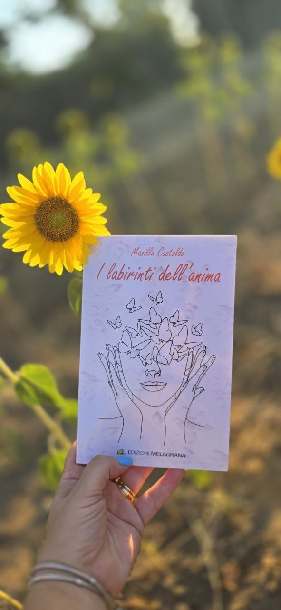
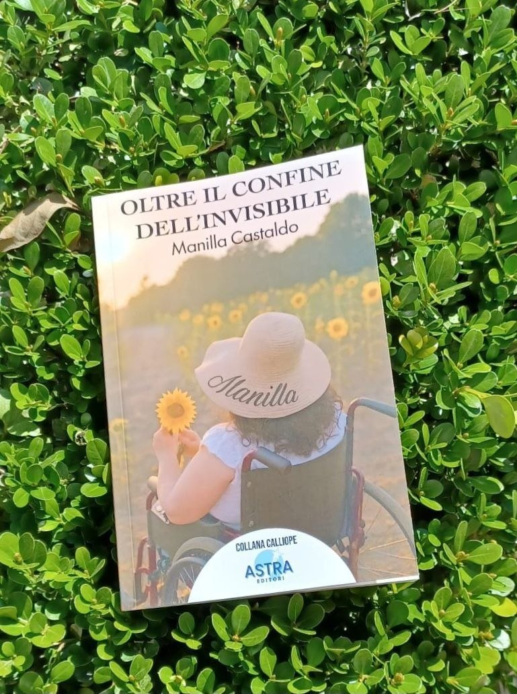
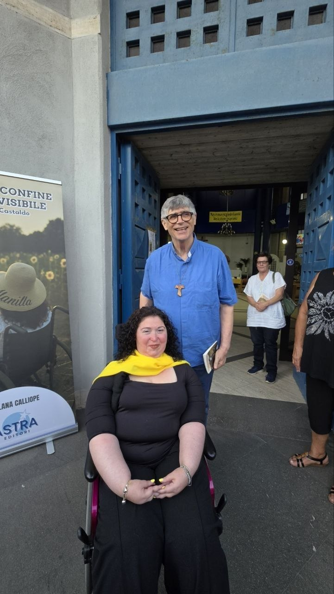
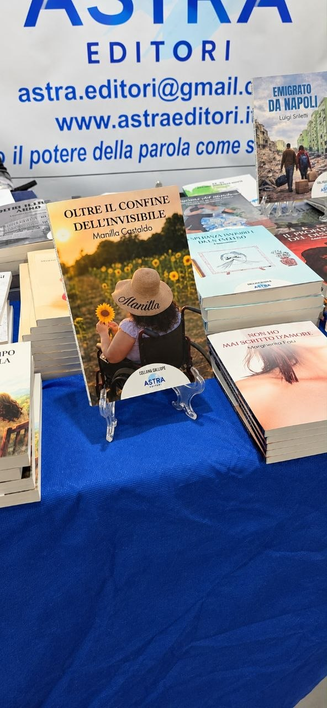
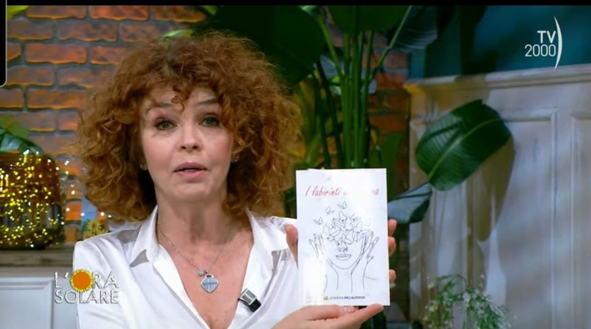
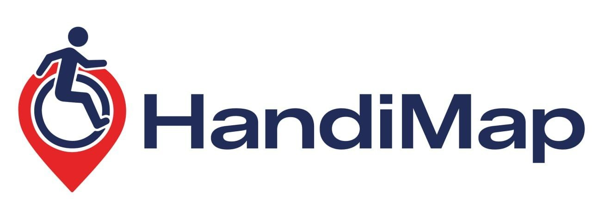
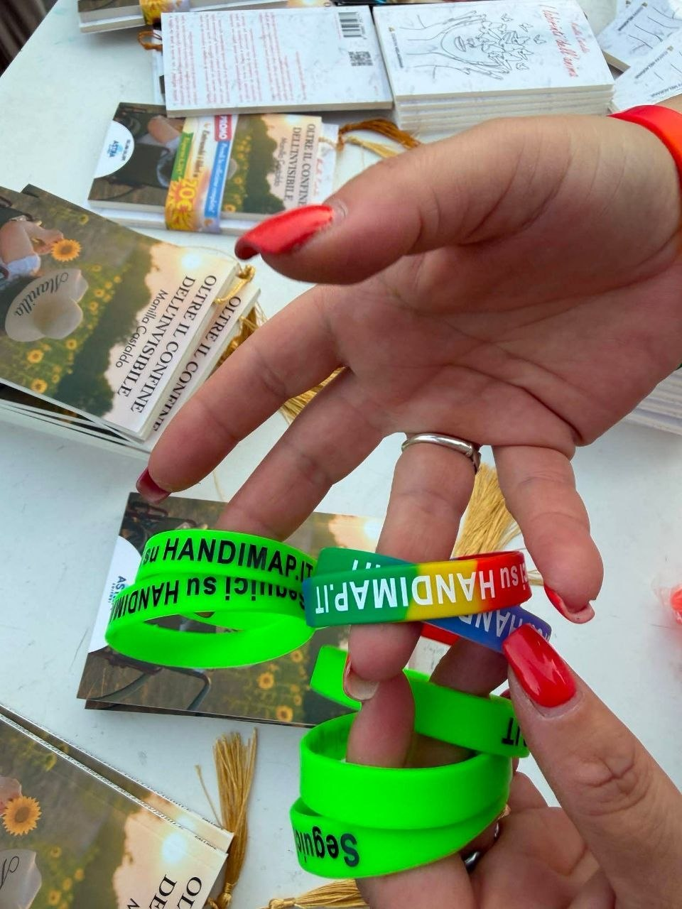
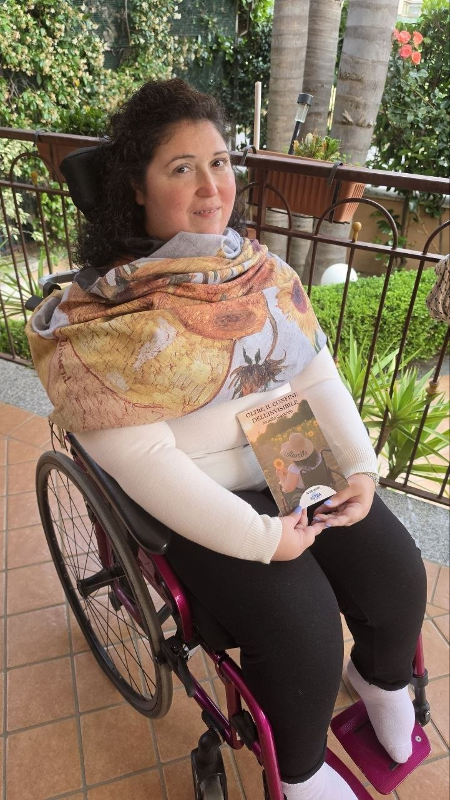

Ci sono periodi in cui si scrive meno, si pubblica meno e si finisce per lasciare in silenzio uno spazio che per tanto tempo ha fatto parte della nostra quotidianità. È quello che è successo al mio blog, *Il Mondo di Baby Pepita*, che negli anni ha raccolto pensieri, passioni, racconti, collaborazioni, recensioni e tanti piccoli pezzi della mia vita.

È stato uno spazio in cui ho avuto modo di conoscere persone, raccontare esperienze, presentare prodotti e progetti, collaborare con aziende e realtà diverse, condividere opinioni e dare voce a iniziative che meritavano attenzione.

Il blog è rimasto fermo per un po', ma io non mi sono fermata.

In questi anni sono successe tante cose, alcune che per me hanno rappresentato vere conquiste, altre che mi hanno portata a scoprire nuove possibilità e a mettermi alla prova.

È arrivata la pubblicazione del mio primo libro di poesie, *I labirinti dell'anima*, nel 2024. Poi un'altra esperienza importante con *Oltre il confine dell'invisibile*, un progetto in cui poesia e disegno si incontrano e raccontano qualcosa di me.

Con i miei libri sono arrivate anche le presentazioni, momenti in cui ho potuto incontrare i lettori di persona, leggere le mie poesie ad alta voce e sentire quanto le parole possano avvicinare le persone.

Ho portato i miei libri e HandiMap anche alle fiere, tra stand, incontri e tante persone con cui condividere storie e il messaggio di inclusione.

Sono arrivati riconoscimenti letterari, premi, menzioni speciali e nuove occasioni per condividere le mie parole. Ho avuto il piacere di partecipare a interviste, incontri e iniziative culturali, fino a vivere anche l'esperienza di far parte di una giuria letteraria.

Tra le emozioni più grandi c'è stata anche la televisione, perché *I labirinti dell'anima* è arrivato su TV2000, nel programma *L'ora solare*.

Nel frattempo è cresciuto un progetto a cui tengo particolarmente, [HandiMap](https://handimap.it), nato dal desiderio di trasformare le parole in qualcosa di concreto e contribuire a una società più accessibile e inclusiva.

Da questo stesso desiderio è nata anche una canzone, [«Muoviamo la città»](https://youtu.be/9OEeyOqW85I), un modo diverso per portare il messaggio di HandiMap a più persone.

Ho continuato anche il mio percorso universitario, le mie esperienze nella comunicazione e nella scrittura, scoprendo che ci sono ancora tante cose che desidero imparare e realizzare.

E mentre tutto questo accadeva, il mio vecchio blog aspettava.

Oggi sono felice di ritrovarlo con una veste nuova e con un nome che porta direttamente il mio, [www.manillacastaldo.it](https://manillacastaldo.it).

Per questo voglio rivolgere un ringraziamento speciale a [DevShare](https://www.devsharesrl.it), che ha recuperato il mio blog, permettendomi di non perdere uno spazio a cui sono affezionata, e ha lavorato alla realizzazione di un vero e proprio sito personale.

Non si tratta soltanto di un restyling, ma di una nuova casa digitale nella quale raccogliere il mio percorso, i miei libri, le pubblicazioni, le esperienze, i progetti, le collaborazioni, le recensioni, le interviste e tutto ciò che nel tempo continuerà a prendere forma.

Grazie per aver dato nuova vita a qualcosa che appartiene alla mia storia e per avermi aiutata a trasformarlo in uno spazio più completo, capace di raccontare chi sono e quello che faccio.

Non voglio che questo sito sia soltanto una raccolta di risultati, ma uno spazio in cui continuare a condividere idee, parole, progetti e nuove esperienze.

Forse il blog è rimasto in silenzio, ma tante pagine della mia vita sono state scritte altrove. Adesso è arrivato il momento di riportarle tutte qui, insieme alle prossime che ancora devo scrivere.

Benvenuti nella mia nuova casa digitale.

Manilla 🌻
